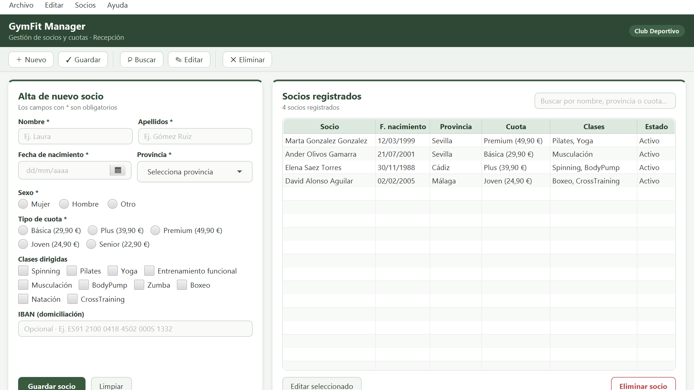

# GymFit Manager


Aplicación de escritorio en **JavaFX** para la gestión diaria de recepción en un club deportivo (altas, edición, búsqueda en tiempo real, cambio de estado y bajas de socios). Rediseñada aplicando los principios de usabilidad y diseño de interfaces de los **Temas 6 y 7 de Desarrollo de Interfaces (2.º DAM)**.



> **Documentación completa:** puedes consultar el análisis heurístico de la pantalla original, las decisiones de rediseño, el minitest con usuarios y las conclusiones en [docs/DI_T67_Rubio_Gallardo_Laura.md](docs/DI_T67_Rubio_Gallardo_Laura.md).

---

## Funcionalidades principales

* **Gestión completa de socios (CRUD):** alta, edición en modo dedicado, duplicado de fichas, cambio de estado (*Activo / Baja*) y eliminación segura con diálogo de confirmación.
* **Validación inteligente orientada a solución:** comprobación de campos obligatorios, edad mínima (14 años) y formato de IBAN español (`ES` + 22 dígitos), mostrando avisos claros con ejemplos reales sin borrar el formulario.
* **Búsqueda y filtrado instantáneo:** filtro en tiempo real por nombre, apellidos, provincia, tipo de cuota o clases dirigidas, con contador dinámico de resultados.
* **Usabilidad en recepción:** formulario compacto en dos columnas sin scroll, controles específicos (`DatePicker` en formato `dd/MM/yyyy`, `ComboBox` con las 50 provincias, `RadioButton` con precios visibles y `CheckBox` para clases), menú contextual de 4 acciones y barra de estado inferior no intrusiva.
* **Identidad visual limpia:** tema luminoso en tonos verdes (*verde bosque*, *verde salvia* y *alabastro*) con acción destructiva reservada en *terracota* (`#B84A4A`).

---

## Estructura del proyecto

```text
DI_T67_GymFit_Manager/
├── docs/
│   ├── img/
│   │   ├── CreacionSocio.png
│   │   ├── EliminacionSocio.png
│   │   ├── IBANErroneo.png
│   │   ├── ModificacionSocio.png
│   │   ├── PantallaPrincipal.png
│   │   └── SocioCreado.png
│   └── DI_T67_Rubio_Gallardo_Laura.md
├── src/
│   └── main/
│       ├── java/
│       │   ├── com/gymfit/manager/
│       │   │   ├── controller/
│       │   │   │   └── GymController.java
│       │   │   ├── model/
│       │   │   │   ├── CuotaTipo.java
│       │   │   │   ├── Sexo.java
│       │   │   │   └── Socio.java
│       │   │   ├── service/
│       │   │   │   └── ServiceSocio.java
│       │   │   ├── validation/
│       │   │   │   └── SocioValidador.java
│       │   │   ├── GymFitApp.java
│       │   │   └── Launcher.java
│       │   └── module-info.java
│       └── resources/
│           └── com/gymfit/manager/
│               ├── css/
│               │   └── styles.css
│               └── fxml/
│                   └── gym.fxml
├── pom.xml
└── README.md
```

---

## Acceso rápido a los archivos clave

| Capa / Sección | Archivo | Descripción |
| :--- | :--- | :--- |
| **Documentación** | [DI_T67_Rubio_Gallardo_Laura.md](docs/DI_T67_Rubio_Gallardo_Laura.md) | Análisis de la pantalla original, rediseño, minitest con usuarios y conclusiones. |
| **Arranque** | [Launcher.java](src/main/java/com/gymfit/manager/Launcher.java) | Punto de entrada `main` para lanzar JavaFX modular sin errores de classpath. |
| **Aplicación** | [GymFitApp.java](src/main/java/com/gymfit/manager/GymFitApp.java) | Carga `gym.fxml`, aplica `styles.css` y configura la ventana (`1280x800`). |
| **Controlador** | [GymController.java](src/main/java/com/gymfit/manager/controller/GymController.java) | Gestiona los eventos de la vista, el filtrado de la tabla y los diálogos. |
| **Vista (FXML)** | [gym.fxml](src/main/resources/com/gymfit/manager/fxml/gym.fxml) | Estructura de la interfaz en `BorderPane` (menús, toolbar, formulario y tabla). |
| **Estilos (CSS)** | [styles.css](src/main/resources/com/gymfit/manager/css/styles.css) | Paleta verde salvia/bosque, tarjetas, botones y estados de foco. |
| **Modelo** | [Socio.java](src/main/java/com/gymfit/manager/model/Socio.java) · [CuotaTipo.java](src/main/java/com/gymfit/manager/model/CuotaTipo.java) · [Sexo.java](src/main/java/com/gymfit/manager/model/Sexo.java) | Entidad principal y enumerados de cuotas (con precio) y sexo. |
| **Servicio** | [ServiceSocio.java](src/main/java/com/gymfit/manager/service/ServiceSocio.java) | Gestión de socios en memoria, datos iniciales y catálogos de provincias y clases. |
| **Validación** | [SocioValidador.java](src/main/java/com/gymfit/manager/validation/SocioValidador.java) | Reglas de negocio (edad, obligatorios e IBAN) con mensajes orientados a solución. |
| **Configuración** | [module-info.java](src/main/java/module-info.java) · [pom.xml](pom.xml) | Declaración del módulo JavaFX y dependencias Maven. |

---

## Atajos de teclado

| Atajo | Acción |
| :---: | :--- |
| `Ctrl + N` | Preparar formulario para un nuevo socio |
| `Ctrl + S` | Guardar socio (alta o cambios en edición) |
| `Ctrl + F` | Enfocar el buscador de la tabla |
| `Ctrl + E` | Cargar el socio seleccionado en modo edición |
| `Ctrl + L` | Limpiar todos los campos del formulario |
| `Supr` | Eliminar el socio seleccionado (con confirmación) |
| `F1` | Abrir la guía rápida de atajos de teclado |
| `Ctrl + Q` | Salir de la aplicación |

---

## Paleta de colores

| Rol | Color | Código Hex |
| :--- | :--- | :---: |
| **Fondo general** | Alabastro suave | `#F4F6F3` |
| **Principal / Cabecera** | Verde bosque | `#2F4835` |
| **Botón primario / Foco** | Verde salvia | `#3A5A40` |
| **Superficies secundarias** | Verde salvia claro | `#EEF3EF` / `#DDE8DF` |
| **Acción destructiva** | Terracota | `#B84A4A` |

---

## Cómo ejecutar el proyecto

### Desde IntelliJ IDEA
1. Clonar el repositorio y abrir la carpeta `DI_T67_GymFit_Manager` como proyecto **Maven**.
2. Esperar a que IntelliJ descargue las dependencias definidas en [`pom.xml`](pom.xml).
3. Ejecutar la clase [`Launcher.java`](src/main/java/com/gymfit/manager/Launcher.java).

### Desde terminal (Maven Wrapper)
```bash
./mvnw clean javafx:run
```
*(En Windows PowerShell o CMD puedes usar `.\mvnw.cmd clean javafx:run`).*

---

## Autora 

**Laura Rubio Gallardo**  
2.º DAM · Desarrollo de Interfaces