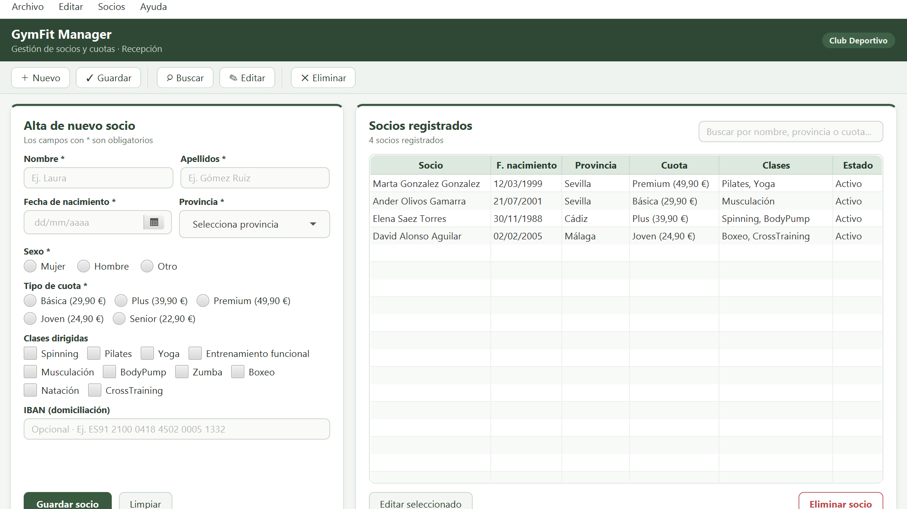
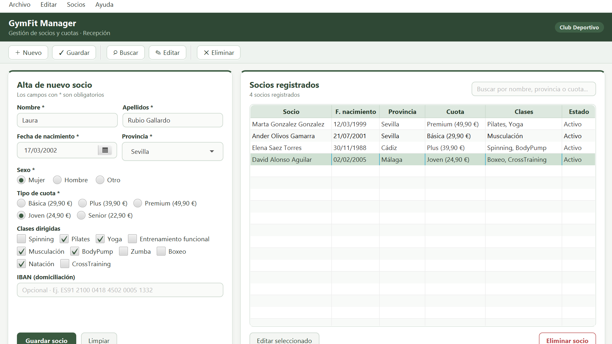
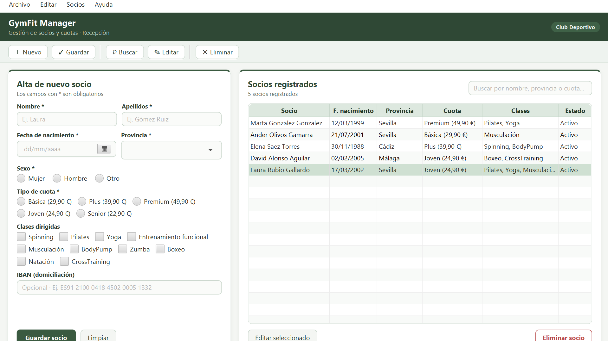
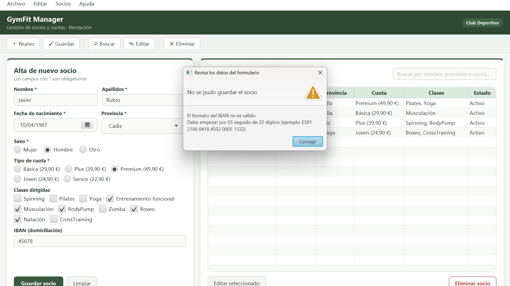
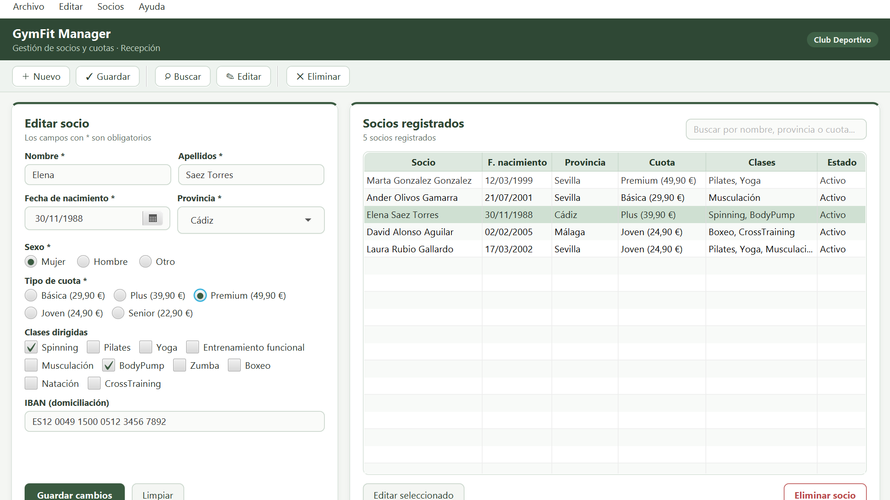
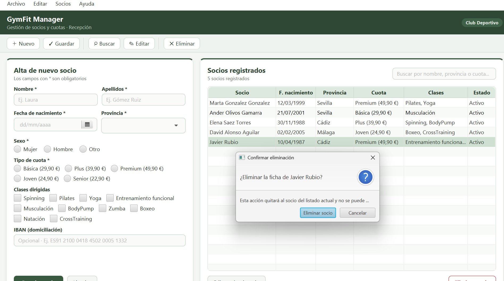

# Documentación de Usabilidad y Rediseño · GymFit Manager

**Alumna:** Laura Rubio Gallardo  
**Módulo:** Desarrollo de Interfaces (2.º DAM)  
**Unidades:** Temas 6 y 7 · Usabilidad y Diseño de Interfaces

---

## 1. Análisis de la pantalla original

Cuando me puse a revisar la pantalla original de **GymFit Manager**, lo primero que me llamó la atención es que parece hecha para ponérselo difícil a quien trabaja en recepción. En un mostrador tienes que dar altas rápido mientras atiendes a la gente, y esta interfaz te obliga a recordar códigos, descifrar iconos raros y navegar por menús eternos solo para guardar una ficha.

Para ordenar los fallos que he encontrado, he usado la escala de gravedad habitual del 0 al 4:
* **0:** Sin problema.
* **1:** Detalle estético (no frena al usuario).
* **2:** Problema menor (molesta un poco al principio, pero se supera).
* **3:** Problema grave (retrasa el trabajo y hace muy fácil equivocarse).
* **4:** Problema crítico (riesgo real de perder datos o bloquear la tarea).

Aquí dejo el resumen de los **10 problemas principales** que detecté y cómo los he resuelto en mi versión:

| # | Zona y problema detectado | Principio de usabilidad afectado | Gravedad | Solución aplicada en mi rediseño                                                                                                                       |
| :-: | :--- | :--- | :-: |:-------------------------------------------------------------------------------------------------------------------------------------------------------|
| **1** | **Menús superiores caóticos:** empieza por *Ayuda*, mete nombres como *COSAS*, *Varios* u *Otros*, y esconde *Guardar socio* tras 6 niveles de submenú. | Consistencia, estándares y regla de los 3 clics (Tema 7). | **3 (Grave)** | He dejado el orden clásico (*Archivo, Editar, Socios, Ayuda*) con nombres claros y atajos de teclado (`Ctrl+S`, `Ctrl+N`, `Ctrl+F`, etc.).             |
| **2** | **Barra de herramientas con iconos indescifrables:** usa símbolos como un sol, un trébol o radiación sin ningún texto que explique qué hacen. | Reconocimiento antes que recuerdo (Tema 6 y 7). | **2 (Menor)** | He puesto botones con icono reconocible + texto claro (*Nuevo, Guardar, Buscar, Editar, Eliminar*) y *tooltip* con su atajo.                           |
| **3** | **Botón destructivo enorme y pegado al resto:** *BORRAR TODO* es gigante, rojo y está al lado de los botones de guardar. Además, mezcla idiomas (*OK, Cancel, Aceptar*). | Prevención de errores y control del usuario (Tema 7). | **4 (Crítica)** | *Guardar socio* es el botón principal en verde. *Eliminar socio* va separado a la derecha, en terracota, y siempre pide confirmación. Todo en español. |
| **4** | **Diálogo `ERROR 0x45` confuso y culposo:** suelta un código técnico, echa la culpa al usuario, usa doble negación (*¿Desea no cancelar?*) y botones *Sí / No*. | Mensajes claros, positivos y con salida (Tema 7). | **4 (Crítica)** | `SocioValidador` explica en lenguaje normal qué campo falla y cómo arreglarlo con un ejemplo, sin borrar lo que ya estaba escrito.                     |
| **5** | **Fecha de nacimiento ambigua:** deja escribir a mano mezclando formatos (`dd/mm/aaaa` y `mm-dd-aa`), muy fácil equivocarse de día y mes. | Control adecuado para cada dato y prevención de errores (Tema 6 y 7). | **3 (Grave)** | He puesto un `DatePicker` configurado en formato español (`dd/MM/yyyy`) con ejemplo visible y validación de edad mínima (14 años).                     |
| **6** | **Sexo y Provincia obligan a memorizar:** pide escribir `H`, `M` u `O` a mano y saberse el código INE de cada provincia. | Minimizar la carga de memoria (Tema 6). | **3 (Grave)** | `RadioButton` con palabras completas para el sexo y un `ComboBox` con los nombres reales de las 50 provincias.                                         |
| **7** | **Cuotas con casillas independientes:** al usar *CheckBox* para las cuotas, deja marcar *Básica* y *Premium* a la vez, lo cual no tiene sentido. | Control adecuado para opciones excluyentes (Tema 7). | **3 (Grave)** | He pasado las cuotas a `RadioButton` en un `ToggleGroup` (solo deja elegir una) y además muestro el precio al lado de cada una.                        |
| **8** | **Clases desordenadas e IBAN sin ayuda:** un desplegable gigante con 34 clases mezcladas y un campo de IBAN sin ejemplo ni explicación. | Ayudas visibles y selección clara (Tema 7). | **2 (Menor)** | Casillas (`CheckBox`) visibles para las clases dirigidas y un campo IBAN opcional con ejemplo español (`ES91 2100...`) y validación si se rellena.     |
| **9** | **Menú contextual saturado:** el clic derecho en la tabla tiene demasiadas opciones y varios submenús en cascada. | Menús contextuales limpios (máx. 7-10 opciones, sin cascadas) (Tema 7). | **3 (Grave)** | Lo he dejado en 4 acciones directas sobre la ficha (*Editar, Duplicar, Activar/Dar de baja* y *Eliminar*), sin cascadas.                               |
| **10** | **Diseño agresivo y tabla sin cabeceras:** fondo amarillo chillón, anuncio fucsia, textos en rojo con exclamaciones y una tabla sin título ni encabezados llena de códigos sueltos. | Diseño limpio, contraste y tablas legibles (Tema 7). | **3 (Grave)** | Paleta tranquila en tonos verdes, sin distracciones, y una tabla con título, contador, buscador y encabezados claros.                                  |

---

## 2. Mi rediseño: GymFit Manager

Para solucionar todo lo anterior, he rediseñado la aplicación desde cero en **JavaFX** (`gym.fxml` + `styles.css` + arquitectura MVC), intentando que sea una herramienta práctica, luminosa y fácil de entender a primera vista.

### Estilo visual y paleta de colores
Quería huir tanto del gris por defecto de JavaFX como de diseños demasiado oscuros o recargados. Me decanté por una estética limpia de gimnasio/wellness en **tonos verdes** y fondos claros (alabastro `#F4F6F3` y tarjetas blancas) para que no canse la vista en jornadas largas:
* **Verde bosque y verde salvia (`#2F4835` / `#3A5A40`):** para la cabecera, los títulos, el foco de los campos y el botón principal (*Guardar socio*).
* **Verde muy suave (`#EEF3EF` / `#DDE8DF`):** para la barra de herramientas, los encabezados de la tabla y la barra de estado inferior.
* **Terracota (`#B84A4A`):** reservado solo para el botón *Eliminar socio*, para que destaque como acción destructiva.

### Organización de la pantalla y controles
He usado un `BorderPane` dividido en tres zonas claras:
1. **Parte superior:** barra de menús con el orden estándar (`Archivo`, `Editar`, `Socios` y `Ayuda`) con atajos de teclado (`Ctrl+N`, `Ctrl+S`, `Ctrl+F`, `Ctrl+E`, `Ctrl+L`, `Supr`, `F1`, `Ctrl+Q`), cabecera corporativa y barra de herramientas con icono, texto y *tooltip* en cada botón.
2. **Parte central:** dos tarjetas lado a lado.
    * **Formulario (izquierda):** organizado en dos columnas (*Nombre / Apellidos* y *Fecha / Provincia*) para que quepa entero en pantalla sin necesidad de hacer scroll. Todos los campos obligatorios llevan `*` y texto de ejemplo (`promptText`). He elegido el control adecuado para cada dato: `DatePicker` con formato español (`dd/MM/yyyy`), `ComboBox` con las 50 provincias reales, `RadioButton` para sexo y cuota (mostrando el precio directamente) y `CheckBox` para las clases dirigidas.
    * **Tabla (derecha):** con encabezados claros, contador dinámico de socios y buscador en tiempo real por nombre, provincia, cuota o clase. También incluye un menú contextual (clic derecho) con 4 opciones directas sin submenús en cascada.
3. **Parte inferior:** una barra de estado discreta que confirma lo que acaba de pasar sin molestar con ventanas emergentes por cada acción.

### Flujo de alta y feedback
Al rellenar los datos de un socio nuevo y pulsar en **Guardar socio**, el registro aparece automáticamente seleccionado en la tabla, el contador sube y la barra inferior confirma el alta.

### Validación y mensajes de error claros
Si falta algún campo obligatorio, la edad es menor de 14 años o el IBAN no cumple el formato español (`ES` + 22 dígitos), `SocioValidador` frena el guardado y muestra un aviso en lenguaje normal que explica **qué ha fallado y cómo corregirlo** con un ejemplo real. El IBAN lo dejé opcional para no frenar un alta rápida en recepción, pero si se escribe, se valida.

### Edición y eliminación segura
* **Edición:** al seleccionar un socio (con el botón *Editar seleccionado*, desde el menú o con clic derecho), sus datos se cargan en el formulario y el título cambia a *"Editar socio"* junto con el botón (*Guardar cambios*), para que el usuario sepa siempre en qué modo está.

* **Eliminación:** el botón *Eliminar socio* está separado a la derecha del todo y en color terracota para evitar clics accidentales. Además, siempre abre un diálogo de confirmación con el nombre del socio y botones con verbos claros (*Eliminar socio* / *Cancelar*).

---

## 3. Minitest con usuarios

Para ver si de verdad se entendía todo sin que yo tuviera que explicar nada, hice una prueba rápida con **2 personas** de perfiles distintos:
* **Usuario 1 (perfil acostumbrado a usar ordenador y apps).**
* **Usuario 2 (perfil de uso básico, menos habituado a programas de gestión).**

### Qué tenían que hacer
A los dos les pedí la misma secuencia desde la pantalla inicial (`1280x800`):
1. Dar de alta a un socio nuevo con cuota *Joven*, dos clases dirigidas y metiendo a propósito un IBAN incompleto para ver si entendían el aviso de error y sabían corregirlo.
2. Buscar a ese socio en la tabla y cambiarle la cuota a *Plus*.
3. Eliminar la ficha confirmando el borrado.

### Resultados de la prueba

| Indicador | Usuario 1 (Perfil habitual) | Usuario 2 (Perfil básico) |
| :--- | :--- | :--- |
| **Tareas completadas** | Sí (3 de 3) | Sí (3 de 3) |
| **Tiempo total** | 1 min 18 seg | 2 min 15 seg |
| **Errores cometidos** | 0 errores | 1 error leve (intentó escribir la fecha con guiones en vez de barras) |
| **Ayuda necesaria** | Ninguna | Ninguna (se guió con el ejemplo del campo) |
| **Satisfacción (1 a 5)** | 5 / 5 | 4,5 / 5 |
| **Observaciones** | Fue muy rápido, usó el clic derecho en la tabla sin dudar y le gustó ver el precio junto a cada cuota. | Agradeció que el formulario quepa entero sin scroll y que el aviso del IBAN le enseñara un ejemplo. Al ir a editar intentó hacer doble clic en la fila antes de ver el botón *Editar seleccionado*. |

---

## 4. Conclusión

Rediseñar la pantalla aplicando los principios de usabilidad de los Temas 6 y 7 se nota muchísimo en el uso real. Pasar de campos libres y mensajes genéricos a controles cerrados, una jerarquía visual clara y validaciones con solución ha hecho que los dos usuarios del minitest pudieran completar todas las tareas sin atascarse ni necesitar ayuda.

A nivel técnico, separar la vista (`gym.fxml`), los estilos (`styles.css`), la validación (`SocioValidador`) y el controlador (`GymController`) me ha permitido pulir el diseño sin romper la lógica de la aplicación. Como mejora futura, a raíz del comentario del Usuario 2 en el minitest, añadiría también la opción de abrir la edición haciendo doble clic sobre la fila de la tabla para hacerlo todavía más ágil.